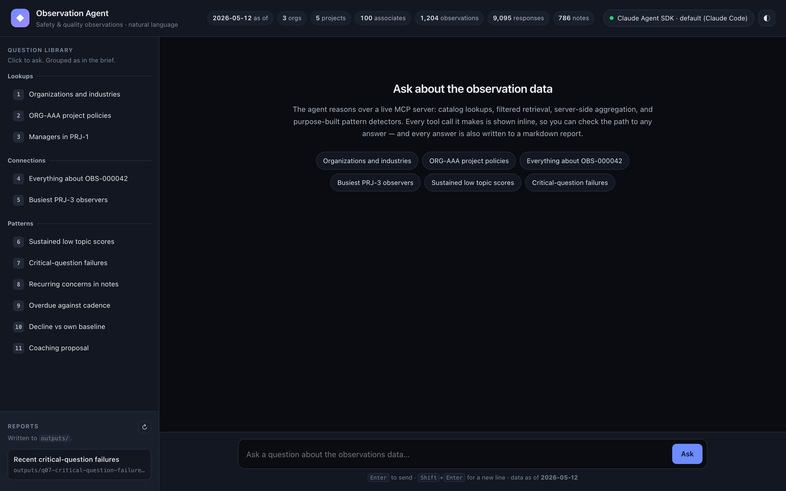
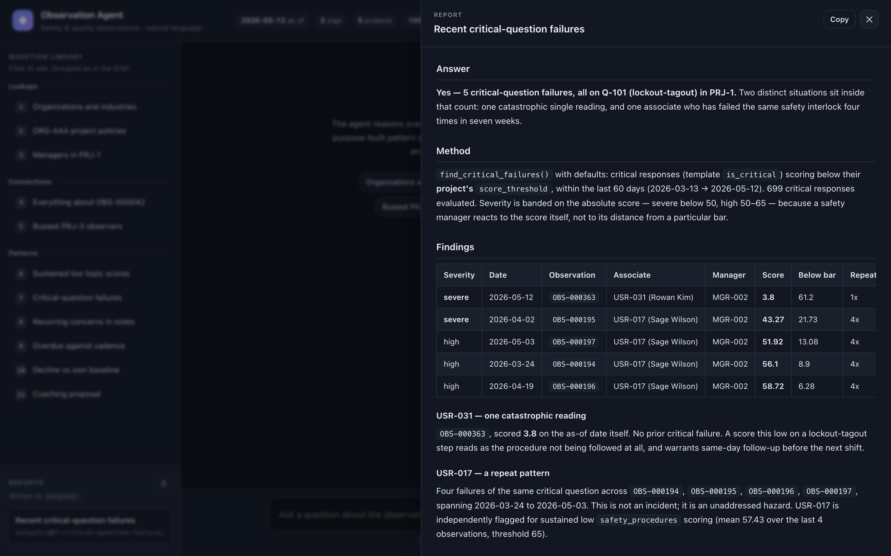
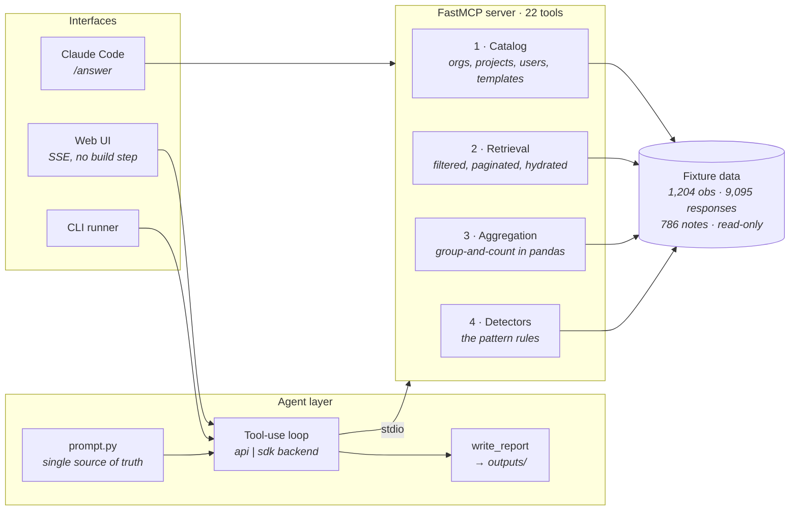

# Observation Agent

A natural-language analyst over a multi-organisation safety &amp; quality observation
platform. Ask a question in plain English — *"are there any recent critical-question
failures a safety manager should worry about?"* — and the agent plans a path through a
FastMCP tool server, computes the answer server-side, cites the records behind it, and
writes a durable markdown report.

Built for the Smart Access observations exercise. The starting point was a FastMCP server
with six list/get tools and an empty agent prompt; **no cross-record filtering or
aggregation existed** — that layer is the work.



<details>
<summary><b>A generated report</b> — every answer is also written to <code>outputs/</code> as a standalone markdown artifact</summary>
<br>

</details>

---

## What's interesting here

**The analysis lives in the tools, not in the prompt.** The naive shape of this project is
a chatty agent that pulls 9,000 response rows into context and does statistics in its head.
Instead the server exposes purpose-built detectors that compute in pandas and return *both*
their findings and the rule they applied — so an answer can state its own definition, and
the numbers are reproducible rather than plausible.

**Judgement calls are parameters with defended defaults.** "Sustained", "meaningfully
declined" and "recurring" are all definitional. Each detector names its rule, explains why
that rule and not a neighbouring one, and takes arguments so a different definition can be
argued rather than hardcoded.

**Every claim is traceable.** Findings carry observation ids, note ids, question ids and
dates. `docs/EXPECTED_ANSWERS.md` is generated ground truth for all eleven exercise
questions, and `tests/` pins the same numbers, so "did the agent get it right" is a
testable question rather than a vibe.

**Two runtimes, one prompt.** The same agent runs as a web app and as a Claude Code
subagent. `agent/prompt.py` is the single source of truth; the Claude Code artifacts are
generated from it, so they cannot drift.

---

## Quickstart

```bash
python3 -m venv .venv && .venv/bin/pip install -e .
```

Then pick a way to reach a model — **either** works:

```bash
export ANTHROPIC_API_KEY=sk-ant-...
```

```bash
claude          # in a terminal, then complete /login
```

Start the web UI:

```bash
.venv/bin/python -m web.app
```

Open <http://127.0.0.1:8080>. The backend badge in the header shows which path is live;
click it for setup detail.

### Other ways in

```bash
.venv/bin/python -m agent.runner "Which associates are past due against their cadence?"
```

```bash
.venv/bin/python -m agent.runner --question-set exercise --only 6,7,11
```

```bash
.venv/bin/python -m agent.runner --list-backends
```

Inside Claude Code, with this directory open:

```bash
/answer In ORG-CCC, which associates have coach notes suggesting a recurring concern?
```

Poke at the tools without an agent:

```bash
.venv/bin/python mcp_server/server.py --transport http   # then curl :8000
```

---

## Architecture



The layering is the efficiency story. A lookup costs one cheap call; a pattern question
costs one analytical call. Nothing needs the 9,000-row response table in context.

| Layer | Tools | Purpose |
|---|---|---|
| **Orientation** | `describe_dataset`, `resolve_entity` | Row counts, policies, and the id traps. One call to get grounded. |
| **1 · Catalog** | `list_organizations`, `list_projects`, `list_users`, `get_user`, `list_templates`, `get_template`, `list_locations` | Small, exact records. Projects carry their cadence/threshold policy. |
| **2 · Retrieval** | `list_observations`, `get_observation`, `get_observation_responses`, `list_coach_notes`, `search_coach_notes` | Filtered and paginated, always with `total_matching`. `get_observation` resolves every foreign key in one call. |
| **3 · Aggregation** | `summarize_observations`, `topic_breakdown`, `get_associate_profile` | Group-and-count server-side; only summary rows travel. |
| **4 · Detectors** | `find_sustained_low_topic_scores`, `find_critical_failures`, `find_cadence_violations`, `find_score_declines`, `find_recurring_note_concerns` | The pattern rules. Each returns findings **and** the rule applied. |

---

## The detectors, and why their defaults

Each rule is a defensible choice, not an arbitrary constant. All are tunable.

| Detector | Default rule | Why this rule |
|---|---|---|
| **Sustained low topic scoring** | For each (associate, topic) pair: ≥ **2 of the last 4** observations below the **project's** threshold | A single bad day cannot reach two. Requiring a strict *consecutive* run would instead miss intermittent lapses — the common real shape. Per-project threshold because 72 passes in PRJ-1 and fails in PRJ-5. |
| **Critical-question failures** | `is_critical` responses below the project threshold, last **60 days**; severity banded on **absolute** score (severe &lt; 50, high 50–65) | A safety manager reacts to "lockout-tagout: 43", not to how far 43 sits under a particular bar. Gap-based banding would rate the same 43 differently per project. `repeat_count` separates an incident from an unaddressed hazard. |
| **Cadence breaches** | `days_since_last − cadence_days − grace`, measured from end of the as-of day, against each associate's **own** project cadence | Cadence ranges 7–30 days across projects, so one global interval is always wrong somewhere. Never-observed associates report separately — a coverage gap, not a late one. |
| **Decline vs own baseline** | Last **3** vs all prior (≥3): drop ≥ **5 points** **AND** ≥ **2.0 baseline SDs** | Self-referential because a slide from 92 to 84 is invisible against a cohort where 84 looks fine. Both tests together: absolute-only flags naturally noisy performers, z-only flags a 1.5-point drop on a very steady one. Baseline SD floored at 1.0. |
| **Recurring note concerns** | ≥ **2** notes in **120 days** carrying recurrence language **and** concern language | *"Again took feedback well"* recurs but is not a concern, so recurrence alone cannot flag. One flagged note is a bad day; two dates or two authors is a pattern. Near-misses returned separately. Keyword heuristic — `candidates_scanned` shows coverage. |

Findings include a `score_context` or `worst_topics` block wherever the numbers can
corroborate — or contradict — the qualitative signal. In this dataset ORG-CCC's recurring
note concern is **not** corroborated by scores, and saying so is the more useful answer.

---

## Verification

```bash
.venv/bin/python -m pytest tests/ -q          # 40 tests
.venv/bin/python scripts/reference_answers.py # regenerate ground truth
.venv/bin/python scripts/sync_prompt.py --check
```

- `tests/test_dataset.py` — row counts, the derived project→template mapping, the `OBS-`
  id collision, per-project policy lookup.
- `tests/test_detectors.py` — every detector pinned to the signals actually in the data, so
  a moved threshold fails loudly instead of quietly changing an answer. Includes a test
  documenting that the note concern-gate is currently *inert* on this corpus.
- `tests/test_agent_loop.py` — the loop with the model replaced by a script: schema
  translation, dispatch into the **real** MCP server, tool-result plumbing, report-path
  containment, turn-limit termination, error surfacing.

---

## Notes on the data

Things that are not in the brief, found while building, and handled:

- **`projects.json` has no `template_id`** despite the brief saying it does. Derived from
  `templates.json` and cross-checked against every observation's `template_id`.
- **`OBS-` is overloaded.** Observers are `OBS-001`–`OBS-020` (3 digits); observations are
  `OBS-000001`–`OBS-001204` (6 digits). `resolve_entity` disambiguates, and
  `get_observation` says so explicitly when handed an observer id.
- **Observer names are not unique.** `OBS-010` and `OBS-011` are both "Blair Davis" — a
  name-keyed ranking would merge them and report 39 observations for one person.
- **`is_critical` exists only on response rows**, never on observation headers.
- **Observers sit outside the management hierarchy** (`manager_id = null`), so "who manages
  project X" means the managers named by that project's *associates*.
- **`OBS-000042` has no coach notes** — reported as an explicit finding, not silence.

---

## Layout

```
.
├── mcp_server/
│   ├── server.py          # 22 tools in 4 layers; thin shell over the modules below
│   ├── dataset.py         # loading, indexes, policy lookup, id classification
│   ├── queries.py         # retrieval + aggregation + the associate dossier
│   └── analytics.py       # the five pattern detectors
├── agent/
│   ├── prompt.py          # system prompt — single source of truth
│   ├── backends.py        # Anthropic API loop | Claude Agent SDK, one event stream
│   ├── mcp_bridge.py      # MCP ⇄ Anthropic tool-schema translation and dispatch
│   ├── reports.py         # write_report, path-contained to outputs/
│   ├── questions.py       # the eleven exercise questions
│   └── runner.py          # CLI
├── web/
│   ├── app.py             # FastAPI + SSE
│   └── static/            # vanilla JS/CSS, no build step
├── .claude/
│   ├── agents/observation-agent.md   # generated from agent/prompt.py
│   ├── commands/answer.md            # generated
│   └── settings.json
├── scripts/
│   ├── sync_prompt.py     # regenerate the Claude Code artifacts
│   └── reference_answers.py
├── data/                  # fixture data, read-only
├── docs/EXPECTED_ANSWERS.md
├── outputs/               # agent-written reports land here
└── tests/
```

## Configuration

| Variable | Default | Effect |
|---|---|---|
| `ANTHROPIC_API_KEY` | — | Enables the Anthropic API backend. |
| `OBSERVATION_AGENT_MODEL` | `claude-opus-5` | Model for the API backend. `claude-sonnet-5` is cheaper and still strong. |
| `OBSERVATION_AGENT_MAX_TURNS` | `24` | Tool-use turn ceiling. |
| `OBSERVATION_AGENT_PORT` / `_HOST` | `8080` / `127.0.0.1` | Web server bind. |
| `OBSERVATIONS_TODAY` | `2026-05-12` | The as-of anchor. All relative windows measure from it. |
| `OBSERVATIONS_DATA_DIR` | `./data` | Point the server at different data. |

The web app has no authentication and binds to loopback by design — it drives an agent with
your own credentials. Don't expose it.

## License

MIT — see [LICENSE](LICENSE).
